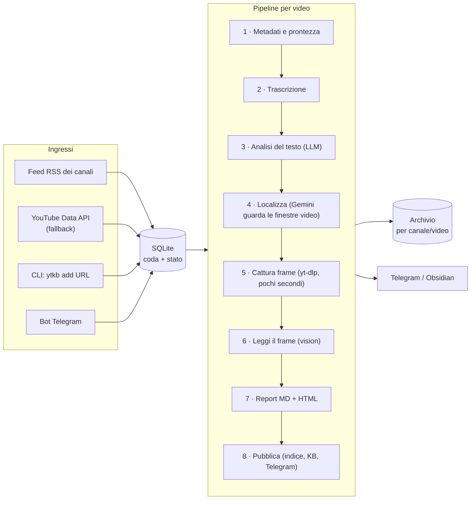
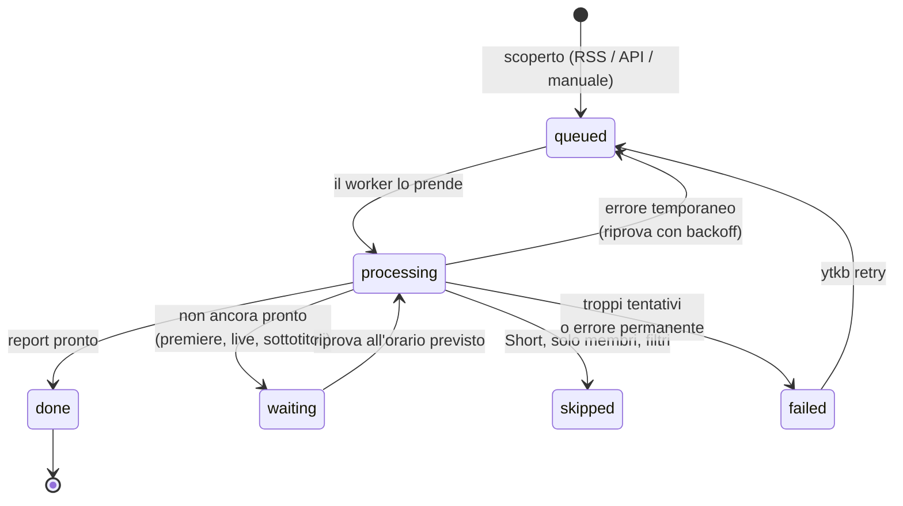
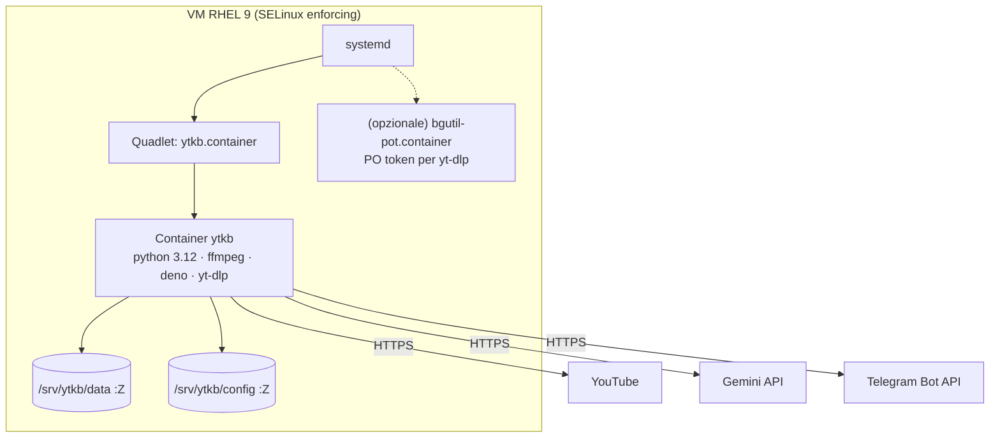

# 03 — Architettura v2: "transcript-first, video-aware"

> **Idea in una riga:** si lavora sul **testo** (economico) per capire *cosa* dice il video e *quando* mostra qualcosa,
> poi si **guarda il video vero** solo in quei pochi momenti, e si scaricano solo i **3 secondi** necessari per lo screenshot.

## 1. Visione d'insieme



Gli stadi 4, 5 e 6 sono **opzionali**: se falliscono il report esce comunque (*degrado elegante*).

## 2. Gli 8 stadi, uno per uno

Ogni stadio produce un **artefatto** (un file) nella cartella del video. Se l'artefatto esiste già ed è valido, lo stadio viene
saltato: è il **checkpoint**. Così un errore allo stadio 5 non fa ripagare l'analisi dello stadio 3.

| # | Stadio | Cosa fa | Artefatto | Se fallisce |
|---|---|---|---|---|
| 1 | `metadata` | Chiede a yt-dlp le informazioni del video **senza scaricarlo** | `metadata.json` | Privato/solo membri → *saltato*; rete → *riprova* |
| 2 | `transcript` | Catena di fonti per la trascrizione, poi divisione in segmenti numerati | `transcript.json`, `transcript.txt` | Sottotitoli non pronti → *in attesa*; poi fallback su Gemini |
| 3 | `analysis` | L'LLM legge il testo e restituisce un JSON validato | `analysis.json` | Riprova con backoff |
| 4 | `locate` | Gemini guarda le finestre video dei momenti visivi, direttamente dal link YouTube | `visual.json` | Si usa il tempo del segmento |
| 5 | `capture` | Scarica pochi secondi per momento e sceglie il frame più nitido | `frames/*.jpg` (+ `clips/*.mp4`) | Report senza immagini ma con link al secondo |
| 6 | `read` | Gemini legge lo screenshot ad alta risoluzione rispondendo alla `vision_question` | `visual.json` (aggiornato) | Resta la descrizione dello stadio 4 |
| 7 | `render` | Genera il report Markdown (Obsidian) e HTML autocontenuto (telefono) | `report.md`, `report.html` | Bug → *fallito* |
| 8 | `publish` | Aggiorna indice del canale e knowledge base, invia la notifica | `channel_index.md` | Riprova solo la notifica |

### Stadio 1 — Metadati e prontezza
yt-dlp in modalità "solo informazioni" restituisce: titolo, canale, durata, lingua, capitoli, se è uno **Short**, se è una
**live** o una **premiere**, se è **pubblico**. Su questi dati decidiamo:

| Situazione | Decisione |
|---|---|
| Short (`media_type = short`) | *saltato* (configurabile) |
| Premiere/live programmata | *in attesa* fino all'orario di inizio + durata stimata |
| Live in corso | *in attesa*, riprova ogni 30 minuti |
| Solo membri / privato | *saltato* |
| Più lungo del massimo (default 3 ore) | *saltato* (configurabile per canale) |
| Altrimenti | avanti |

### Stadio 2 — Trascrizione (catena di fallback)
Si prova una fonte alla volta, nell'ordine configurato:

1. **youtube-transcript-api** — veloce, solo testo. Preferisce i sottotitoli manuali, poi quelli automatici, nella lingua originale.
2. **Sottotitoli via yt-dlp** — strada diversa per lo stesso dato (a volte una funziona quando l'altra è bloccata).
3. **Gemini sul link YouTube** — Gemini "ascolta" il video e trascrive con i tempi. Non scarichiamo niente.
4. *(Ultima spiaggia, opzionale)* audio scaricato e trascritto.

Se il video è appena uscito e non ci sono ancora sottotitoli, prima di passare a Gemini si **aspetta** (20, 40, 60, 120 minuti):
spesso i sottotitoli automatici arrivano e costano zero.

Poi i frammenti grezzi (2–5 secondi l'uno) vengono **uniti in segmenti di ~20 secondi** e numerati:

```text
[S041 12:58] adesso passiamo a bitcoin timeframe giornaliero
[S042 13:12] come vedete qui il prezzo è tornato sul supporto dei 60.000
[S043 13:27] se lo perdiamo in chiusura daily il prossimo livello è 56.500
```

### Stadio 3 — Analisi del testo (LLM, passaggio 1)
Il modello riceve metadati + trascrizione segmentata e deve restituire un JSON conforme allo schema
(`src/ytkb/llm/schemas.py`). Estratto di esempio:

```json
{
  "video_type": "HYBRID",
  "tldr": ["BTC rialzista finché tiene 60.000 in chiusura daily", "S&P500 neutrale in attesa del CPI"],
  "worth_watching": {"score": 3, "reason": "Setup BTC chiaro, il resto è ripetitivo",
                     "best_ranges": [{"start_segment": 41, "end_segment": 58, "reason": "setup BTC"}]},
  "assets": [{
    "asset": "BTCUSD", "timeframe": "1D", "bias": "BULLISH",
    "thesis": "Rimbalzo sul supporto dei 60.000",
    "levels": [{"value": 60000, "kind": "SUPPORT", "segment_id": 42, "spoken_text": "supporto dei 60.000"}],
    "invalidation": "chiusura giornaliera sotto 60.000", "segment_ids": [41, 42, 43]
  }],
  "visual_triggers": [{
    "start_segment": 42, "end_segment": 43, "trigger_type": "PRICE_CHART", "importance": 5,
    "asset": "BTCUSD", "needs_video_clip": false,
    "spoken_context": "come vedete qui il prezzo è tornato sul supporto",
    "vision_question": "Quali livelli orizzontali sono disegnati sul grafico e a che prezzo?"
  }]
}
```

Regole chiave (imposte dal prompt **e verificate dal codice**):
- l'LLM cita **ID di segmento**, mai orari → il codice calcola `13:12` dal segmento 42;
- ogni livello porta le **parole esatte** (`spoken_text`) → il codice le cerca nella trascrizione: se le trova il numero è 🗣️, altrimenti 🤖;
- ID di segmento fuori intervallo vengono corretti o scartati.

### Stadio 4 — Localizza (Gemini guarda il video vero)
Per ogni momento visivo (massimo 8, i più importanti) si chiede a Gemini di guardare **solo quella finestra** del video,
passando il link YouTube con inizio e fine:

```python
{"type": "video", "uri": "https://www.youtube.com/watch?v=ID",
 "processing": {"type": "static", "start_offset": "789s", "end_offset": "810s", "fps": 1},
 "resolution": "high"}
```

Risposta di esempio: *"Grafico giornaliero BTCUSD su TradingView; linea orizzontale a 60.000; momento più chiaro: 9 secondi
dall'inizio della clip"* → il codice calcola il secondo esatto (789 + 9 = 798 → 13:18).
Se Gemini dice che a schermo c'è solo la webcam, il momento viene scartato.

### Stadio 5 — Cattura chirurgica
**Una sola** chiamata yt-dlp per tutti i momenti (meno richieste a YouTube), scaricando solo ±1,5 secondi attorno a ogni
secondo scelto, solo video, max 1080p. Da ogni pezzetto `ffmpeg` estrae 3 fotogrammi e teniamo il **più nitido**
(varianza del Laplaciano, scarto dei frame uniformi tipo dissolvenze). Risultato: `frames/13m18s_price_chart_BTCUSD.jpg`.

Le clip video (`clips/*.mp4`) sono **opzionali** (default spente): il report ha sempre il link al secondo esatto su YouTube.

### Stadio 6 — Leggi il frame
Lo screenshot 1080p viene mandato a Gemini insieme a `spoken_context` e `vision_question`. Le letture tornano come
etichetta + valore (es. *"Resistenza: 64.480"*) e nel report sono marcate 👁️ *letto dal grafico*.

### Stadio 7 — Report
Da un unico "modello del report" si generano due file:
- `report.md` — per **Obsidian**: intestazione YAML (tag, asset, bias…), link relativi alle immagini;
- `report.html` — **autocontenuto** (immagini incorporate), leggibile dal telefono, inviabile su Telegram.

### Stadio 8 — Pubblica
- aggiorna `channel_index.md` del canale;
- indicizza trascrizione e menzioni nella knowledge base (fase 6);
- manda su Telegram il riassunto breve + il report HTML.

## 3. Ciclo di vita di un video (macchina a stati)



| Stato | Significato | Esempio |
|---|---|---|
| `queued` | Pronto da lavorare (subito o a `next_attempt_at`) | Video appena aggiunto |
| `waiting` | YouTube non è ancora pronto | Premiere alle 21:00 |
| `processing` | In lavorazione (con lo stadio corrente) | `stage = analysis` |
| `done` | Report pronto | |
| `skipped` | Scartato di proposito (con motivo) | `skip_reason = short` |
| `failed` | Fallito dopo i tentativi (con errore) | `last_error = ...` |

Tentativi dopo un errore temporaneo: 5, 15, 60, 180, 720 minuti (configurabile).

## 4. Componenti del codice

```text
src/ytkb/
├── cli.py               # comandi: ytkb add / process / status / channels / run / telegram / doctor ...
├── config.py            # settings.yaml + .env → oggetti validati (refusi = errore chiaro)
├── db.py                # SQLite: videos (coda), channels, events, llm_calls, kv (migrazioni con user_version)
├── errors.py            # NotReady / Temporary / Blocked / Permanent / Skip
├── models.py            # modelli di dominio: VideoMeta, Transcript, segmenti, stati, stadi
├── doctor.py            # ytkb doctor (anche --deep: prove reali su YouTube e Gemini)
├── monitor.py           # controllo dei canali e delle playlist "da riassumere"
├── daemon.py            # ytkb run: polling + worker + bot, arresto pulito
├── youtube/             # tutto ciò che parla con YouTube (adapter)
│   ├── urls.py          #   link → ID, link al secondo esatto, riferimenti ai canali
│   ├── ytdlp.py         #   opzioni comuni yt-dlp (Deno, proxy, cookie) + classificazione errori
│   ├── metadata.py      #   stadio 1
│   ├── transcripts.py   #   stadio 2 (catena di fonti + segmentazione)
│   ├── media.py         #   stadio 5 (sezioni di pochi secondi + ffmpeg)
│   ├── feeds.py         #   feed RSS
│   ├── dataapi.py       #   YouTube Data API (piano B, risoluzione @nome)
│   └── channels.py      #   channels.yaml, import Takeout
├── llm/                 # tutto ciò che parla con l'AI (adapter)
│   ├── base.py          #   interfaccia LLMProvider + Part (testo, immagine, video YouTube)
│   ├── gemini.py        #   implementazione con la Interactions API
│   ├── fake.py          #   provider finto per test e prove senza chiave
│   ├── schemas.py       #   schemi Pydantic degli output + conversione in JSON Schema
│   ├── transcribe.py    #   fonte di trascrizione "gemini_url"
│   ├── costs.py         #   stima costi dai token
│   └── prompts/*.md     #   prompt in file separati (in italiano)
├── pipeline/
│   ├── context.py       #   contesto con gli adapter (iniettabili nei test)
│   ├── workspace.py     #   cartella del video, scritture atomiche, checkpoint
│   ├── readiness.py     #   Short, live, premiere, filtri
│   ├── postprocess.py   #   verifiche sull'output LLM (segmenti, provenienza numeri)
│   └── runner.py        #   orchestrazione degli stadi + macchina a stati
├── visual/              # stadi 4-6: stage.py, framepick.py (nitidezza), models.py
├── report/              # view-model, etichette, template Jinja2 (md, html), indice del canale
└── notify/              # telegram.py (notifiche + bot), format.py (messaggio breve)
```

Principio: **il dominio non conosce l'esterno.** YouTube, Gemini e Telegram stanno dietro piccoli adapter che nei test
vengono sostituiti da finti (*fake*). Così i test girano senza rete e senza costi.

## 5. Dati su disco

```text
data/                                   # ignorata da git
├── state/ytkb.db                       # SQLite (stato, coda, costi)
├── work/                               # file temporanei (cancellati a fine lavoro)
└── archive/
    └── Trading_Facile/
        ├── channel_index.md
        └── 2026-10-26_BTC_e_SP500_settimana_decisiva_[dQw4w9WgXcQ]/
            ├── report.md               # per Obsidian
            ├── report.html             # autocontenuto, per telefono/Telegram
            ├── metadata.json           # dati YouTube del video
            ├── transcript.json         # segmenti con tempi
            ├── transcript.txt          # leggibile: [MM:SS] testo
            ├── analysis.json           # output LLM validato
            ├── visual.json             # localizza + lettura frame
            ├── frames/13m18s_price_chart_BTCUSD.jpg
            └── clips/                  # opzionale
```

Rispetto al v1: `metadata.json` ora contiene i **dati di YouTube**, mentre l'output dell'LLM sta in `analysis.json`
(nel v1 erano mescolati).

## 6. Deploy su RHEL 9 (fase 5)



- Nessuna porta in ingresso: il bot Telegram usa il *long polling* (la VM chiama Telegram, non viceversa).
- Un solo container con il comando `ytkb run` (polling + worker + bot).
- Aggiornamento di yt-dlp all'avvio del container e ricostruzione settimanale dell'immagine.
