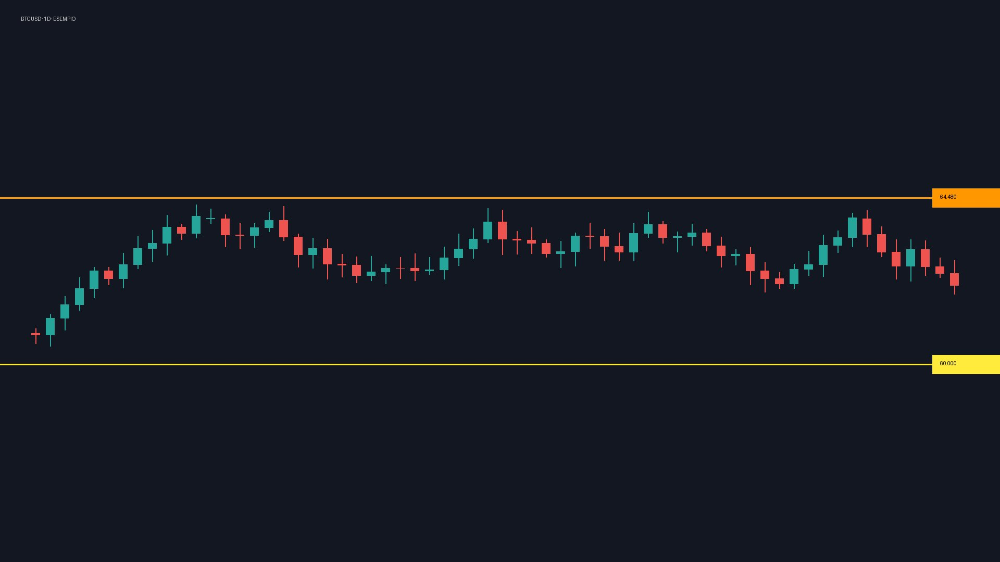

# ESEMPIO — BTC e S&P500: settimana decisiva?

> **Trading Facile** · 26 ottobre 2026 · 2 min · [▶ Guarda su YouTube](https://www.youtube.com/watch?v=ESEMPIO0001)
> Misto (operativo + teoria) · trascrizione automatica, sottotitoli YouTube, lingua it

## ⚡ In 30 secondi
- BTC rialzista finché tiene 60.000 in chiusura giornaliera
- S&P 500 neutrale in attesa del CPI di giovedì
- Tre regole per disegnare un supporto

## 🎯 Vale la pena guardarlo? ★★★☆☆ (3/5)
Setup BTC chiaro, resto generico
- ▶ [00:17–00:46](https://youtu.be/ESEMPIO0001?t=17) — setup BTC

## 📝 Riassunto
L'autore analizza Bitcoin e S&P 500 e spiega come disegnare i supporti.

## 📈 Analisi operativa

### BTCUSD — Bitcoin · 🟢 Rialzista · 1D
Rimbalzo sul supporto dei 60.000

| Livello | Tipo | Provenienza | Quando | Nota |
|---|---|---|---|---|
| **60.000** | Supporto | 🗣️ detto a voce | [00:17](https://youtu.be/ESEMPIO0001?t=17) | ha retto tre volte |
| **56.500** | Obiettivo | 🗣️ detto a voce | [00:17](https://youtu.be/ESEMPIO0001?t=17) | se perde 60.000 |
| **64.480** | Resistenza | 🤖 non verificato | [00:34](https://youtu.be/ESEMPIO0001?t=34) | esempio: numero che NON compare nella trascrizione |

- **Invalidazione:** chiusura giornaliera sotto 60.000
- **Se ne parla a:** [00:17](https://youtu.be/ESEMPIO0001?t=17) · [00:34](https://youtu.be/ESEMPIO0001?t=34)

#### 🖼️ Grafico di prezzo · BTCUSD · [00:22](https://youtu.be/ESEMPIO0001?t=22)

> 🗣️ *"prezzo sul supporto dei 60.000"*
> 👁️ **A schermo:** Grafico giornaliero BTCUSD su TradingView con due linee orizzontali
> ❓ Quali livelli orizzontali sono disegnati? → Linea gialla a 60.000 (supporto) e arancione a 64.480 (resistenza)
> - 👁️ Supporto: **60.000** *(leggibilità alta, da verificare sullo screenshot)*
> - 👁️ Resistenza: **64.480**

### SPX — S&P 500 · ⚪ Neutrale · 4H
Laterale tra 5.750 e 5.900 fino al CPI

| Livello | Tipo | Provenienza | Quando | Nota |
|---|---|---|---|---|
| **5.750** | Supporto | 🗣️ detto a voce | [00:58](https://youtu.be/ESEMPIO0001?t=58) |  |

- **Se ne parla a:** [00:58](https://youtu.be/ESEMPIO0001?t=58)

## 🎓 Concetti e metodo

### Come disegnare un supporto
Servono almeno due minimi.

1. Almeno due minimi
2. Più tocchi = più forza
3. Conferma in chiusura

↪ [01:22](https://youtu.be/ESEMPIO0001?t=82)

## 🌍 Macro ed eventi
- **Inflazione USA:** Mercato laterale fino al dato ([00:58](https://youtu.be/ESEMPIO0001?t=58))
  - 📅 CPI giovedì

## 🖼️ Altri riferimenti visivi

#### 🖼️ Slide didattica · [01:44](https://youtu.be/ESEMPIO0001?t=104)
> 🗣️ *"slide con le tre regole"*
> 👁️ **A schermo:** Slide con tre regole numerate
> ❓ Trascrivi le regole della slide → 1) due minimi 2) più tocchi 3) conferma in chiusura
> ⚠️ Screenshot non disponibile (download bloccato da YouTube): usa il link per vedere il momento esatto.

## 🧭 Capitoli
- [00:00 — Intro](https://youtu.be/ESEMPIO0001?t=0)
- [00:17 — Bitcoin](https://youtu.be/ESEMPIO0001?t=17)
- [01:22 — Teoria](https://youtu.be/ESEMPIO0001?t=82)

## ⚠️ Note
- 💼 **Sponsor / conflitto di interessi:** Sponsor: broker XYZ
- 🖼️ 1 screenshot non scaricato: c'è il link al secondo esatto.

---
*Provenienza dei numeri: 🗣️ detto a voce (verificato nella trascrizione) · 👁️ letto dal grafico (da verificare) · 🤖 non verificato.*
*Report generato da yt-finance-kb il 27 ottobre 2026, 00:52. Riassume le opinioni dell'autore del video: non è una raccomandazione di investimento.*
*Trascrizione completa: [transcript.txt](transcript.txt)*
